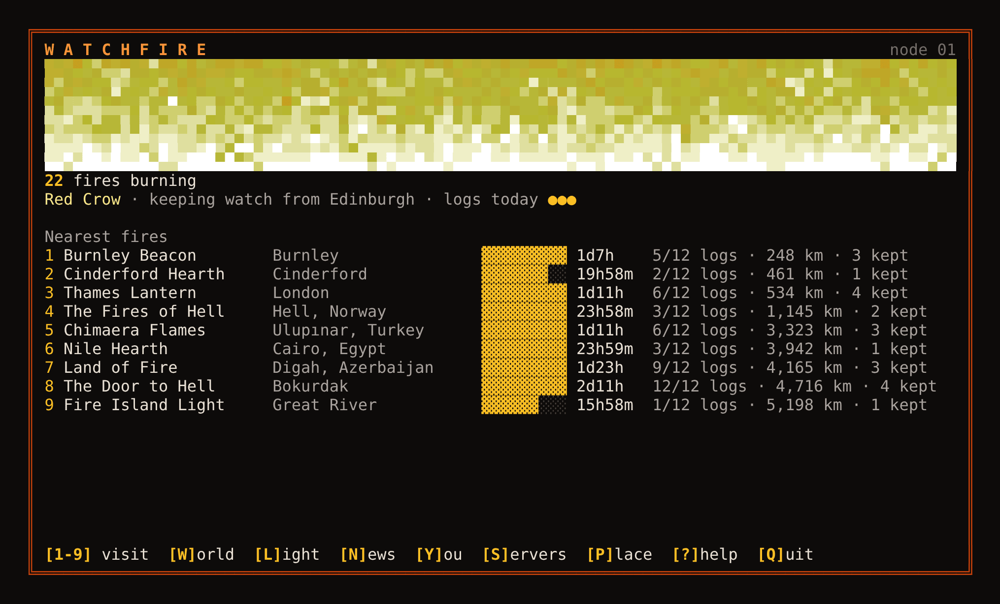
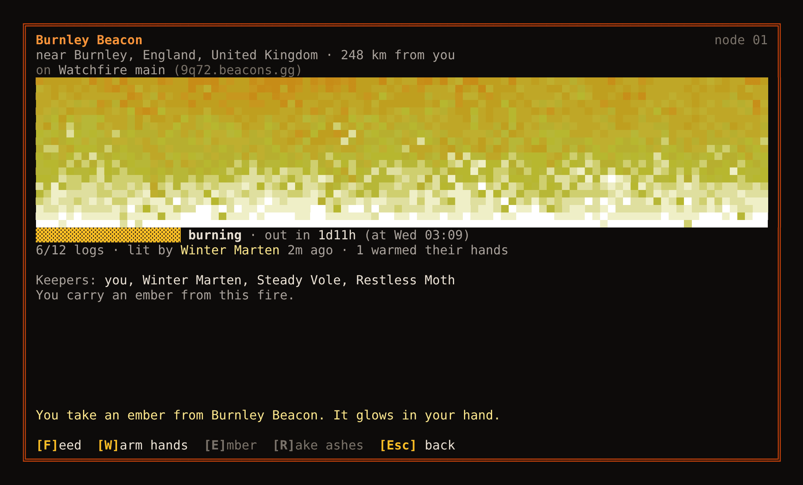
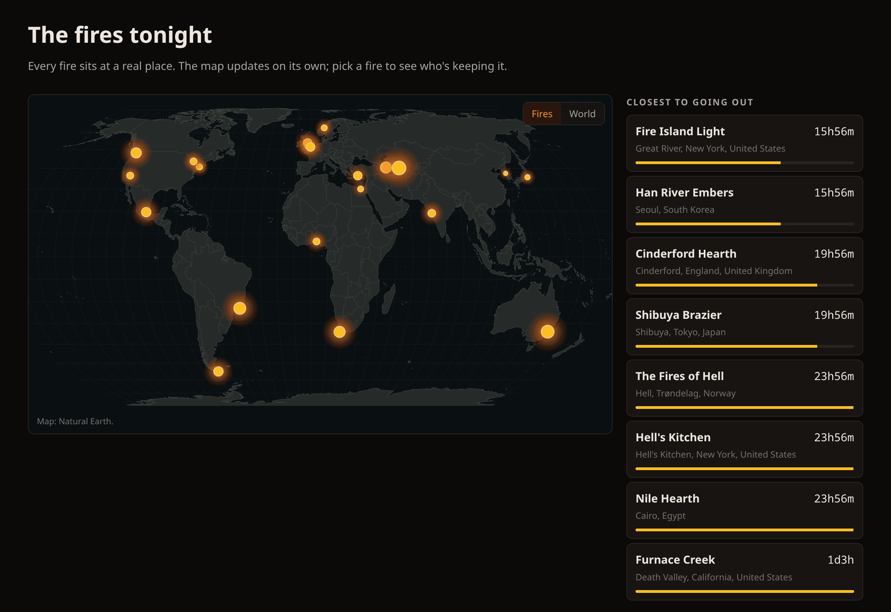

# Watchfire

> Somewhere in the world, a fire is about to go out. You have three logs today.

Watchfire is a BBS-style door game played in a terminal, either on your own computer or over SSH. Fires burn at real places on the map. Every day you get three logs to keep them alive. Fires nobody tends go dark, and nobody can keep one going alone for long, so fires live because strangers chose them. A visit takes about a minute.



Watchfire runs on [Beacon](https://beacons.gg), and it's also an example of building a game on it. Fires live in Beacon rooms, where room policies enforce the game rules. Watchfire has no game backend of its own.

## Play

The easiest way to play is on your own computer. Download Watchfire for Windows, macOS, or Linux from the [latest release](https://github.com/beacons-gg/games.watchfire/releases/latest), unpack it, and run `watchfire` in a terminal. On Linux:

```sh
tar -xzf watchfire-*-linux-x64.tar.gz
./watchfire-*-linux-x64/watchfire
```

Windows and macOS each need one extra step the first time; the release notes and [how to play](docs/how-to-play.md#playing-on-your-own-computer) walk you through it.

The first time, Watchfire creates your keeper (your identity in the game) and stores it in your home folder. Back it up: in the game, **Y** then **K** shows your 12 recovery words. You can restore it on another computer with `watchfire import`.

The game tells you when a newer version is available. Run `watchfire --help` for other commands.



### Play over SSH

Watchfire also supports the old BBS tradition of *door games*: games hosted on a remote computer that you enter through a terminal connection. Connect to a Watchfire door over SSH and play without downloading anything. The door's website shows its address.

```sh
ssh -p 2222 <the door's address>
```

Your SSH key identifies your keeper. Without one, you enter as a guest and can watch, but not lay logs. SSH is also a convenient way to play from a phone.

Both the downloaded game and SSH doors connect to the same shared world. You don't need to run a door or host a Beacon server to play.

See [how to play](docs/how-to-play.md) for the rules, the keys, and step-by-step instructions for each computer.

## How it uses Beacon

Everything that matters between players is held by Beacon servers, so the game needs no server of its own:

- **A fire is a Beacon room.** Its policy (`packages/core/src/policy.ts`) holds the rules: only logs go on, each log pushes the fire's "out" time back 4 hours, a fire holds 180 logs at most, and once it's out it's ash. The server enforces these rules for every player, so a modified client can't break them.
- **Rewards come from the room.** Once a fire holds 5 logs, each of its keepers may take one ember, and the server makes sure it's only one.
- **Reads are open.** Anyone can read the world without an account, which is how the website shows the fires live.
- **Your identity is a Beacon account.** It works on every Beacon server, and your profile name shows up in other Beacon games.
- **Other games can join in.** Players of any Beacon game can warm their hands at a fire, and do nothing else there.

[docs/beacon-integration.md](docs/beacon-integration.md) has the full fire policy, what the server enforces and what it doesn't, and the gotchas we hit along the way.

## Run a door

A door is a shared SSH entry point into Watchfire, continuing the tradition of BBS door games. It lets people connect and play through a terminal without installing the game. Each door also serves a website showing the world's fires live.



Running a door is optional. Doors connect to existing Beacon servers, and players with the downloaded game connect to the same world directly.

The door runs as a single Docker image, with the SSH game on port `2222` and its website on port `8080`. Its own data is stored in Postgres.

```sh
cp .env.example .env
echo "WATCHFIRE_MASTER_KEY=$(openssl rand -hex 32)" >> .env
echo "WATCHFIRE_DB_PASSWORD=$(openssl rand -hex 24)" >> .env
docker compose up -d --build
ssh -p 2222 localhost
```

Keep a secure backup of `WATCHFIRE_MASTER_KEY`: it's the only way to open the keepers the door holds.

For settings, backups, Dokploy, an external database, and sysop commands, see [docs/run-a-door.md](docs/run-a-door.md).

## Develop

You'll need Node 24 (through nvm) and pnpm. Everything installs from npm, including Beacon's SDK (`@beaconsgg/*`).

```sh
nvm use
pnpm install
pnpm typecheck && pnpm test
WATCHFIRE_FIRE_TYPE=watchfire-dev pnpm play   # play with test fires, invisible to normal play
pnpm door             # SSH door on :2222 and its website on :8080
```

Plain `pnpm play` connects to the shared world at `9q72.beacons.gg`, so your moves affect the same fires as everyone else's.

```text
packages/core     @watchfire/core: rules, fire policy, reading the world, Beacon moves
apps/cli          The terminal game (Ink), run locally or inside a door
apps/door         The SSH door, its storage, and the website's server
apps/dashboard    The website (Vite + React)
scripts/          Checks against real Beacon servers, seed fires, local test servers
```

[CONTRIBUTING.md](CONTRIBUTING.md) covers the rest: tests against real and local Beacon servers, building, and releasing. To report a security issue privately, see [SECURITY.md](SECURITY.md).

## Docs

| Doc | What it covers |
| --- | --- |
| [how-to-play.md](docs/how-to-play.md) | Playing on your own computer or over SSH, the rules, and the keys |
| [game-design.md](docs/game-design.md) | Why a terminal game, the core loop, the rules and their tuning, the screens, and ideas for later |
| [beacon-integration.md](docs/beacon-integration.md) | How Watchfire uses Beacon: the fire policy, what the server enforces, several servers, profiles, and gotchas |
| [architecture.md](docs/architecture.md) | The monorepo: the shared core, the game, the door, and the website |
| [run-a-door.md](docs/run-a-door.md) | Running a door: Docker, settings, backups, sysop commands, and how it works |

## Credits

City names from [GeoNames](https://www.geonames.org) (CC BY 4.0). Map data from [Natural Earth](https://www.naturalearthdata.com) (public domain).

## License

[Apache License 2.0](LICENSE).
